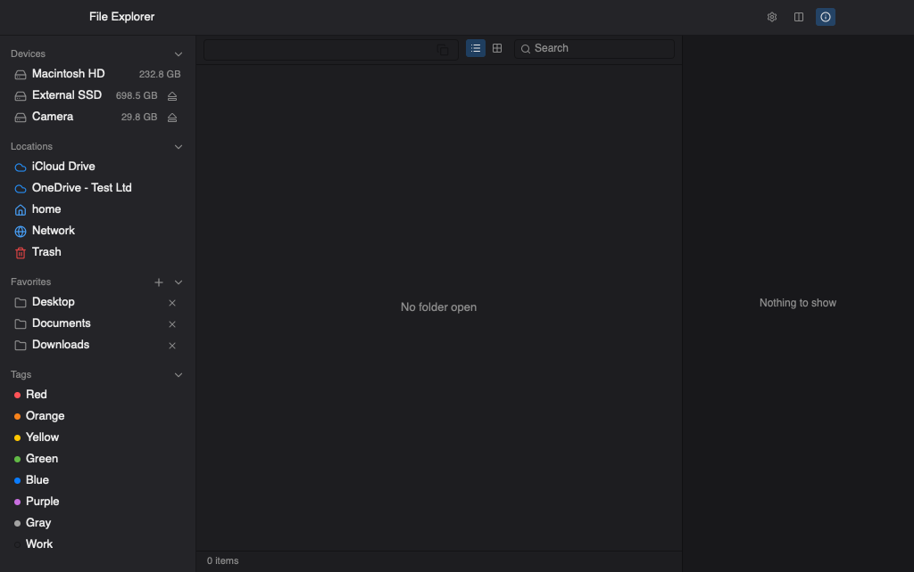

# File Explorer

A native macOS file manager, written in Rust on [GPUI](https://gpui.rs) — the
GPU-accelerated UI framework behind [Zed](https://zed.dev).

It looks like a Mac app and behaves like **Windows File Explorer**. That is the
point, not an accident: if you move between Windows and macOS and the Finder
keeps fighting your muscle memory, this is for you.

> **Status: v0.1.0, early.** Local file management works and is well covered by
> tests. It is not signed or notarised yet, so macOS will ask you to approve it
> once — see [Installing](#installing).



## Why it exists

Finder and Explorer disagree about a dozen small things, and the disagreements
are exactly the ones that live in your fingers. This app takes Explorer's side,
adapted to a Mac keyboard:

| | File Explorer | Finder |
|---|---|---|
| Open an item | `Enter` or double-click | `Cmd-O` (`Enter` renames) |
| Rename | `F2` | `Enter` |
| Delete to Trash | `Delete` | `Cmd-Delete` |
| Go up a folder | `Backspace` or `Alt-Up` | `Cmd-Up` |
| Editable path | click the breadcrumb, or `Cmd-L` | no equivalent |
| Cut / paste files | `Cmd-X` / `Cmd-V`, cut items dim | no cut |
| Sorting | folders grouped first | mixed |
| Free space | always in the status line | hidden |

## What works today

- **Browsing** — virtualised list, natural sort, folders first, sortable
  columns, folders expandable in place, type-ahead, hidden-file toggle
- **Navigation** — back/forward history that restores your cursor and scroll,
  an editable path with autocomplete, breadcrumbs
- **File operations** — cut/copy/paste, duplicate, inline rename, Trash and
  permanent delete, drag and drop, a job queue with progress, conflict
  resolution (Replace / Skip / Keep both), and undo
- **Two views** — details list and icon grid with QuickLook thumbnails
- **Split panes** — two independent panes; splitting opens whatever folder you
  have highlighted
- **Info panel** — preview, metadata, and a live permissions grid
- **Search** — instant filter of the current folder, or a streamed recursive
  walk
- **Finder tags** — read and write the real `_kMDItemUserTags`, so tagging here
  shows up in Finder
- **Open with** — populated from Launch Services, so any editor you install
  appears automatically. Zed and VS Code open in a **new window on the Space
  you are looking at**, rather than yanking you to another desktop
- **Themes** — four built-ins, light/dark following the system, plus any JSON
  theme you drop in the themes folder (hot-reloaded while running)

The path field names **what you have highlighted**, not just the folder you are
in — including a file's full path — with a copy button, a tooltip, and
`Copy Path` in the right-click menu.

## Installing

Download the `.dmg` from
[Releases](https://github.com/nanderto/file-explorer/releases), open it, and
drag **File Explorer** to Applications.

The first launch needs one extra step, because the app is **not notarised**
(that requires a paid Apple Developer membership):

1. Open it once — macOS will refuse.
2. Go to **System Settings → Privacy & Security**, scroll to **Security**, and
   click **Open Anyway**.

> Right-click → Open does *not* work for this. macOS 15 removed that bypass for
> software that is not notarised.

Prefer the Terminal? This does the same thing:

```sh
xattr -dr com.apple.quarantine "/Applications/File Explorer.app"
```

The app is ad-hoc signed, so macOS can verify it has not been tampered with
since it was built — Apple just has not vouched for it.

## Building from source

Requires a [Rust](https://rustup.rs) toolchain and macOS.

```sh
# run it
cargo run -p file-explorer-app --bin file-explorer

# build a real .app (and a .dmg)
./scripts/bundle.sh --dmg
cp -R "target/bundle/File Explorer.app" /Applications/
```

## Keyboard

| | |
|---|---|
| `Enter` | open |
| `Backspace` / `Alt-Up` | go up |
| `Cmd-[` / `Cmd-]` | back / forward |
| `Cmd-L` | edit the path |
| `F2` | rename |
| `Delete` / `Shift-Delete` | Trash / delete permanently |
| `Cmd-X` `Cmd-C` `Cmd-V` | cut, copy, paste |
| `Cmd-D` | duplicate |
| `Cmd-Z` / `Cmd-Shift-Z` | undo / redo |
| `Cmd-Shift-N` | new folder |
| `Cmd-F` | search |
| `Cmd-1` / `Cmd-2` | list / icon view |
| `Cmd-Shift-O` | split panes |
| `Cmd-Shift-I` | info panel |
| `Cmd-Shift-.` | show hidden files |
| `Cmd-,` | settings |

Every binding is overridable in `keymap.json` beside `settings.json`.

## Configuration

`~/Library/Application Support/file-explorer/`

- `settings.json` — favorites, recents, theme, behaviour toggles
- `keymap.json` — keybinding overrides
- `themes/` — drop a JSON theme here and it appears in Settings, hot-reloaded

## Development

| | |
|---|---|
| Build | `cargo build --workspace --all-targets` |
| Test | `cargo test --workspace` |
| Lint | `cargo clippy --workspace --all-targets -- -D warnings` |
| Everything CI runs | `bash scripts/gate.sh push` |

The workspace is three crates: `fs-core` (all filesystem logic, no UI, tests
headless on any platform), `theme` (the theme model and loader), and `app` (the
GPUI application).

Worth reading before contributing:

- [`CLAUDE.md`](CLAUDE.md) — the quality gate, enforced by hooks and CI
- [`docs/ARCHITECTURE.md`](docs/ARCHITECTURE.md) — the entity graph and the
  keybinding traceability table
- [`docs/AS_BUILT.md`](docs/AS_BUILT.md) — what is actually built, including
  known gaps and deviations from the plan

## Licence

MIT — see [LICENSE](LICENSE). Third-party components and their licences are
listed in [THIRD-PARTY-NOTICES.md](THIRD-PARTY-NOTICES.md).
